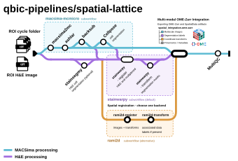

<h1>
  <picture>
    <source media="(prefers-color-scheme: dark)" srcset="docs/images/logo-darkmode.svg">
    
  </picture>
</h1>

[](https://github.com/codespaces/new/nf-core/spatiallattice)
[](https://github.com/nf-core/spatiallattice/actions/workflows/nf-test.yml)
[](https://github.com/nf-core/spatiallattice/actions/workflows/linting.yml)[](https://nf-co.re/spatiallattice/results)[](https://doi.org/10.5281/zenodo.XXXXXXX)
[](https://www.nf-test.com)

[](https://www.nextflow.io/)
[](https://github.com/nf-core/tools/releases/tag/4.0.2)
[](https://www.docker.com/)
[](https://sylabs.io/docs/)

## Introduction

**qbic-pipelines/spatial-lattice** is a bioinformatics pipeline for the processing of multiplexed imaging data generated by the MACSima Imaging Cyclic Immunofluorescence (MACSima) platform, optionally register with corresponding H&E stained tissue sections.

The pipeline takes raw MACSima ROI cycle folders or a complete study (and, optionally, H&E images), stages, converts and optionally performs intensity correction of the raw acquisition data with `macsima2mc`, registers the individual tiles into whole-slide images with `ASHLAR`, and performs optional background subtraction, cell/nuclei segmentation with `Cellpose 3`, `Cellpose 4` and/or `Mesmer`, and H&E tissue segmentation. It can process either a single ROI at a time or an entire MACSima project folder in batch, automatically extracting the experimental metadata (experiment, rack, well, ROI) from the directory structure. The integrated prototype produces a calibrated OME-Zarr artifact and a MultiQC report. It currently requires a per-ROI MACSima/H&E pair and Cellpose 3. See the [implementation review and migration notes](docs/prototype_subworkflows.md).



The prototype groups processing into three subworkflows:

1. **MACSIMA_MCMICRO** stages MACSima cycles, stitches tiles with ASHLAR, optionally subtracts background and segments with Cellpose 3.
2. **SPATIAL_INTEGRATION_STAINWARPY** is the default image registration and optional moving-mask transformation path.
3. **SPATIAL_INTEGRATION_RAMI2D** is the alternative path, implemented with new modules and selected with `--registration_backend rami2d`.

The chosen registration path feeds the required **BUILD_INTEGRATED_OMEZARR**, followed by MultiQC. Reference Cellpose labels stay in the MACSima frame; optional moving labels are transformed once and exported alongside registered H&E. Native registration files are retained as provenance. RAMI2D native-to-reference NGFF transform conversion is not yet implemented; its already-registered image and labels share the calibrated reference grid.

See [prototype setup, containers and tests](docs/prototype_subworkflows.md) before running this development branch. OME vector ROIs remain in the [backlog](#deferred-ome-roi-objects-and-vector-spatial-annotations).

## Usage

> [!NOTE]
> If you are new to Nextflow and nf-core, please refer to [this page](https://nf-co.re/docs/get_started/environment_setup/overview) on how to set-up Nextflow. Make sure to [test your setup](https://nf-co.re/docs/get_started/run-your-first-pipeline) with `-profile test` before running the workflow on actual data.

First, prepare a samplesheet with your input data that looks as follows:

`project_samplesheet.csv` (used when `--project` is enabled):

```csv
project,MACSima_project_folder,HnE_folder
PROJECT_1,/path/to/macsima/project/folder,/path/to/hne/folder
```

Each row represents a MACSima project. When `--project` is set, the pipeline walks the project directory structure and automatically extracts the experiment, rack, well, and ROI metadata from the folder hierarchy, so no per-ROI information is required in the samplesheet.

`samplesheet.csv` (used when `--project` is disabled):

```csv
experiment,sample,rack,well,roi,raw_images_ROI,HnE_ROI
EXP_1,SAMPLE_1,R1,A1,ROI1,/path/to/raw/roi/folder,/path/to/hne/roi/file
```

Each row represents a single ROI to be processed. The `raw_images_ROI` column points to the parent folder of the raw MACSima tiles, which contains one or more cycle folders.

Now, you can run the pipeline using:

```bash
nextflow run nf-core/spatiallattice \
   -profile <docker/singularity/.../institute> \
   --input samplesheet.csv \
   --outdir <OUTDIR>
```

> [!WARNING]
> Please provide pipeline parameters via the CLI or Nextflow `-params-file` option. Custom config files including those provided by the `-c` Nextflow option can be used to provide any configuration _**except for parameters**_; see [docs](https://nf-co.re/docs/running/run-pipelines#using-parameter-files).

For more details and further functionality, please refer to the [usage documentation](https://nf-co.re/spatiallattice/usage) and the [parameter documentation](https://nf-co.re/spatiallattice/parameters).

## Pipeline output

To see the results of an example test run with a full size dataset refer to the [results](https://nf-co.re/spatiallattice/results) tab on the nf-core website pipeline page.
For more details about the output files and reports, please refer to the
[output documentation](https://nf-co.re/spatiallattice/output).

## Development backlog

### Current priority: three prototype subworkflows

Implement the blocks shown in the [metro map](docs/images/metromap.svg) in this order:

1. **MACSIMA_MCMICRO**: group macsima2mc, ASHLAR, optional background subtraction and the existing segmentation workflow. Retain Cellpose 3 for the example run and preserve the current processing behaviour.
2. **SPATIAL_INTEGRATION_STAINWARPY (default)**: group the existing registration and transformation modules, exposing a common result contract for registered images, optional segmentation masks, transforms, calibration, provenance and QC. Keep Stainwarpy's registration algorithm unchanged.
3. **SPATIAL_INTEGRATION_RAMI2D (alternative)**: build all required Nextflow modules from scratch, with pinned Docker containers, tests and the same result contract. Do not base implementation on repairing the inherited RAMI2D wrappers.

Both spatial integration paths should feed the required **BUILD_INTEGRATED_OMEZARR** subworkflow before MultiQC. For this milestone, supported spatial annotations are **segmentation masks only**. Masks already in the reference frame should retain that frame; moving-image masks should use the corresponding image transform with label-preserving interpolation. Vector ROI support is deferred and must not block these three subworkflows.

The [shared registration contract](docs/prototype_registration.md), [RAMI2D design notes](docs/rami2d_prototype.md) and [OME-Zarr integration documentation](docs/integrated_omezarr.md) provide background. This scope decision supersedes any earlier suggestion in those design notes to reuse inherited RAMI2D modules or implement vector annotations during the first prototype.

### Deferred: OME ROI objects and vector spatial annotations

- [ ] Add import, transformation, validation and export of OME ROI objects after the three subworkflows and their image/mask integration are working.

**Goal.** Carry annotations defined on a source image into the same calibrated reference coordinate system as the integrated images, regardless of whether Stainwarpy or RAMI2D produced the registration. Initial geometries should be 2D points/positions, circles/ellipses and polygons. Preserve the original annotations alongside derived coordinates so the transformation can be audited or repeated.

**OME model considerations.** An OME ROI can contain multiple shapes. Preserve ROI/shape identifiers, image references, names, descriptions and annotation links where available, together with optional plane/channel/time associations (`TheZ`, `TheC`, `TheT`). OME represents a circle as an ellipse with equal X/Y radii; points use X/Y positions and polygons use closed coordinate sequences. Account for any existing per-shape transform rather than silently dropping it. Consult the [OME ROI model](https://ome-model.readthedocs.io/en/stable/developers/roi.html) when specifying the importer and round-trip behaviour.

**Work to resume later:**

1. **Define the annotation contract.** Extend the common registration result with optional annotation assets, their source image and coordinate-system identifiers, geometry type, stable object IDs and properties. Distinguish the pipeline's sample/acquisition `roi` identifier from an OME ROI object ID. Absence of annotations must remain valid.
2. **Make coordinate conventions explicit.** Record axis order (image arrays commonly use Y/X; geometries use X/Y), units, physical pixel sizes, origin, pixel-centre convention, crop offsets and transform direction/composition order. Preserve native coordinates and calibration. Label assumed calibration as assumed; do not silently substitute physical units for unknown pixel sizes.
3. **Implement geometry adapters outside the registration algorithms.** Reuse the accepted image-registration transform chain. Verify the mapping needed to move source points into the reference frame: an image-resampling transform may map output coordinates back into the input image, so it cannot automatically be applied to source points in the same direction. Do not assume a numerical inverse exists for every nonlinear transform.
4. **Handle shape changes explicitly.** Transform points directly. Under general affine mappings, circles can become ellipses; retain an exact representation where the selected format supports it. Under nonlinear mappings, polygon edges and curved boundaries need sampling/densification with a documented error tolerance in physical units. Define policies for invalid geometries, out-of-bounds coordinates, unsupported shapes and non-invertible mappings; never silently discard objects.
5. **Decide on storage and interoperability.** Evaluate OME-XML ROI import/export and a future SpatialData representation. Specify how annotation assets link to the integrated OME-Zarr coordinate systems and images. RFC-5 describes coordinate systems and transformations; it is not by itself a vector ROI serialization format. Record the chosen schema/version and reader support before declaring compatibility. Preserve backend-native transform files as provenance when a mapping cannot be represented faithfully in the chosen standard.
6. **Preserve traceability.** Store source checksums, object-ID mappings, software/container versions, transform parameters, calibration, any geometry approximation tolerance and validation results. Avoid applying a registration twice to annotations already expressed in the reference frame.
7. **Add small, deterministic tests before tissue-scale validation.** Use synthetic points, circles and polygons with identity, translation, rotation and affine transforms; include anisotropic pixels, nonzero crop offsets, axis-order checks and known mapping direction. Check image/mask/vector landmark agreement, ID/property preservation, missing annotations and separation of two samples/ROIs. Where an inverse is supported, test round trips with explicit tolerances. Add nonlinear geometry tests only when that capability is introduced.
8. **Validate in a viewer.** Overlay transformed annotations, images and masks in napari (and later SpatialData tooling), inspect known landmarks, and distinguish successful file export from biologically acceptable alignment. Keep visual QC and quantitative coordinate checks as separate acceptance criteria.

**Lessons to carry forward from the Myocarditis review.** Retain crop/grid offsets and native data, distinguish measured from provisional calibration, keep manual reference mappings separate from automatic results, and record registration channels and QC. A completed registration run does not establish alignment quality. These requirements should already inform image/mask provenance in the first prototype; implementing vector ROIs can wait.

**References and restart points:**

- [OME ROI model and shape semantics](https://ome-model.readthedocs.io/en/stable/developers/roi.html).
- [OME XML schemas](https://www.openmicroscopy.org/Schemas/) — select and record the schema used for ROI interchange.
- [NGFF RFC-5: coordinate systems and transformations](https://ngff.openmicroscopy.org/rfc/5/) — recheck specification status and reader support when implementation resumes.
- [SpatialData documentation](https://spatialdata.scverse.org/en/stable/) — future integration target; evaluate point/shape models and coordinate transformations.
- [RAMI2D documentation and source](https://github.com/VictorDidier/RAMI2D) and [H&E / immunofluorescence example](https://github.com/VictorDidier/RAMI2D/blob/main/examples/imf_he.sh) — verify capabilities against the pinned version; image/label support must not be assumed to provide vector support.
- [Pipeline registration contract](docs/prototype_registration.md), [RAMI2D proposal](docs/rami2d_prototype.md), and [current OME-Zarr exporter](docs/integrated_omezarr.md).

## Credits

qbic-pipelines/spatial-lattice was originally written by [Carolin Schwitalla](https://github.com/CaroAMN) in collaboration with [Maximilian Wirth](https://github.com/WirthMax), [Victor Perez](https://github.com/VictorDidier), [Luis Kuhn Cuellar](https://github.com/luiskuhn), and Nadya Panagides.

We thank the following people for their extensive assistance in the development of this pipeline:

[Thusheera Kumarasekara](https://github.com/tckumarasekara)

## Contributions and Support

If you would like to contribute to this pipeline, please see the [contributing guidelines](docs/CONTRIBUTING.md).

For further information or help, don't hesitate to get in touch or open issues.

## Citations

<!-- TODO nf-core: Add citation for pipeline after first release. Uncomment lines below and update Zenodo doi and badge at the top of this file. -->
<!-- If you use nf-core/spatiallattice for your analysis, please cite it using the following doi: [10.5281/zenodo.XXXXXX](https://doi.org/10.5281/zenodo.XXXXXX) -->

<!-- TODO nf-core: Add bibliography of tools and data used in your pipeline -->

An extensive list of references for the tools used by the pipeline can be found in the [`CITATIONS.md`](CITATIONS.md) file.

You can cite the `nf-core` publication as follows:

> **The nf-core framework for community-curated bioinformatics pipelines.**
>
> Philip Ewels, Alexander Peltzer, Sven Fillinger, Harshil Patel, Johannes Alneberg, Andreas Wilm, Maxime Ulysse Garcia, Paolo Di Tommaso & Sven Nahnsen.
>
> _Nat Biotechnol._ 2020 Feb 13. doi: [10.1038/s41587-020-0439-x](https://dx.doi.org/10.1038/s41587-020-0439-x).
